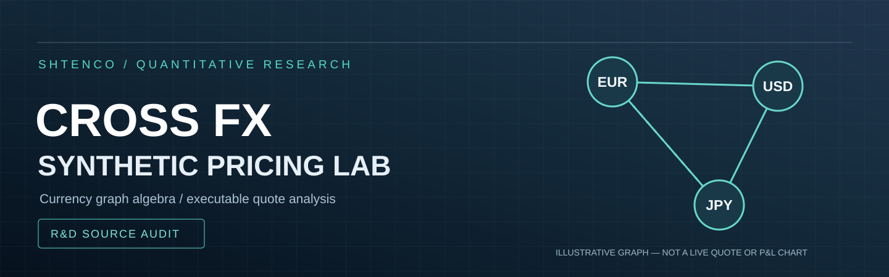
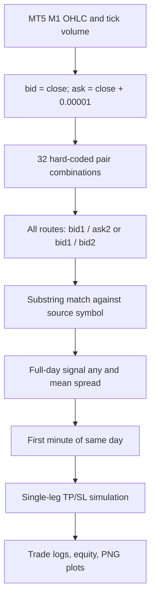
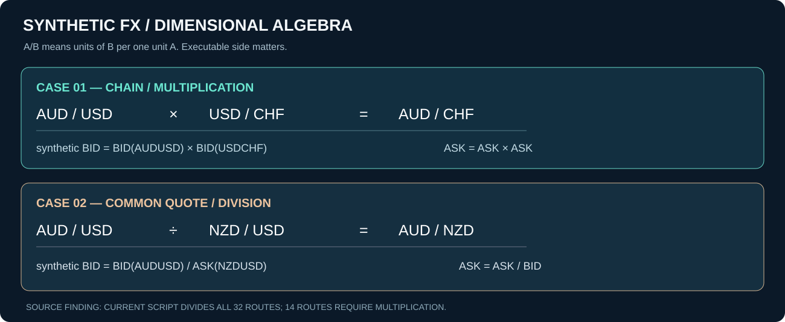
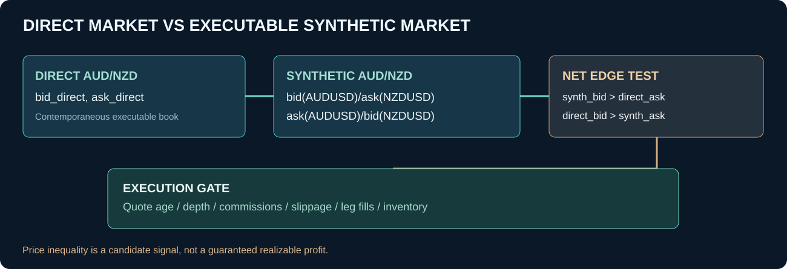
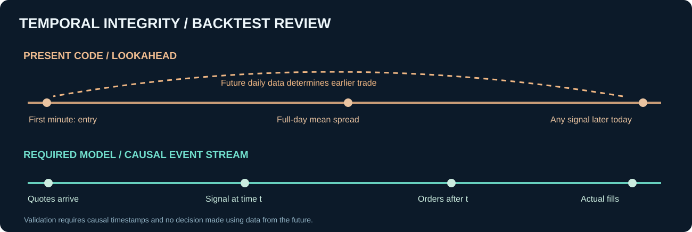
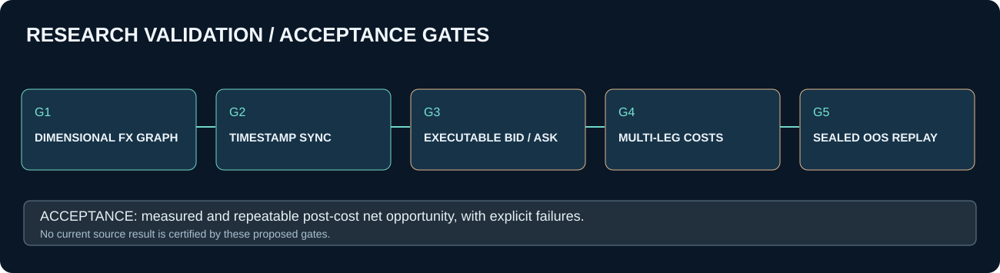

<div align="center">



**CROSS FX / SYNTHETIC PRICING RESEARCH**

Математика валютных маршрутов, исполнимые стороны bid/ask, микроструктура, проверка временной причинности и независимая оценка арбитража.

[Постановка](#постановка-и-инженерная-ценность) · [Фактический код](#архитектура-текущего-исходника) · [Математика](#валютная-алгебра-и-bidask) · [Аудит](#критические-выводы-аудита) · [Верификация](#исследовательская-программа) · [Запуск](#воспроизведение)

</div>

> **Статус: исследовательский Python/MT5 прототип, не доказанный арбитражный движок.** Исходник вычисляет синтетические ряды и моделирует однопарные TP/SL-сделки. Он не осуществляет трёхногий атомарный арбитраж, не использует реальные исторические bid/ask-стаканы и не доказывает чистую прибыль после исполнения. Старое описание сохранено в [историческом README](docs/README_LEGACY.md), но его показатели не прошли независимую проверку.

## Постановка и инженерная ценность

Рыночные цены различных валютных пар связаны арифметическими тождествами. Например, конвертация AUD в CHF может происходить прямо через AUDCHF либо через два последовательных обмена AUD→USD→CHF. При корректно сопоставленных, исполнимых котировках расхождение может стать кандидатом на круговую обменную операцию; однако задержки, спреды, глубина книги, исполнение отдельных ног и издержки часто уничтожают теоретический сигнал.

Проект представляет инженерную основу для **cross-rate consistency monitor** — системы сравнения прямых и синтетических валютных путей. Потенциальные применения: контроль качества брокерских котировок, выявление аномалий потоков, исследование latency и временной синхронизации, тестирование графовых алгоритмов и симуляция multi-leg execution. Это **возможности последующей разработки**, а не подтверждённые работающие сервисы.

## Архитектура текущего исходника

Файл [`cross_forex_arbitrage_trading.py`](cross_forex_arbitrage_trading.py) содержит класс `ForexArbitrageSystem` и точку входа `main()`. В нём заданы **25 базовых валютных инструментов**, **32 двухпарные комбинации** и два способа построения синтетического ряда, то есть до **64 вычисляемых столбцов** при полном наборе данных.



Изученные функции:

| Функция | Фактическое действие | Ключевое ограничение |
|:--|:--|:--|
| `initialize_mt5` | Соединяется с терминалом по фиксированному Windows-пути | Переносимость и брокерская конфигурация |
| `get_historical_data` | Получает M1-бары и создаёт искусственные bid/ask | Это не исторические исполнимые котировки |
| `calculate_synthetic_prices` | Строит синтетические колонки делением | Часть валютных путей требует умножения |
| `analyze_arbitrage_opportunities` | Вычитает синтетику из bid исходной пары, найденной по тексту имени | Сравниваются не те валютные размерности |
| `simulate_trade` | Моделирует TP/SL по строкам bid/ask | Неверные стороны входа, без реального fill |
| `backtest` | Ищет любые сигналы за день и торгует с его начала | Заглядывание в будущее |
| `generate_report` | Печатает PnL и метрики сделок | Drawdown рассчитывается некорректно |
| `plot_equity_curve`, `plot_trade_distribution` | Рисует локальные изображения | Графики зависят от недостоверной бухгалтерии |

## Валютная алгебра и bid/ask



Для котировки \(X/Y\) числовое значение означает количество единиц валюты \(Y\) за единицу \(X\). Это правило размерности позволяет автоматически определять необходимую операцию.

### Общая промежуточная валюта — умножение

\[
\frac{AUD}{USD}\times\frac{USD}{CHF}=\frac{AUD}{CHF}.
\]

Исполнимые границы при независимых котировках двух прямых пар:

\[
B_{AUDCHF}^{synthetic}=B_{AUDUSD}\cdot B_{USDCHF},
\qquad
A_{AUDCHF}^{synthetic}=A_{AUDUSD}\cdot A_{USDCHF}.
\]

Здесь \(B\) — bid, \(A\) — ask.

### Общая котируемая валюта — деление

\[
\frac{AUD}{USD}\div\frac{NZD}{USD}=\frac{AUD}{NZD}.
\]

Тогда

\[
B_{AUDNZD}^{synthetic}=\frac{B_{AUDUSD}}{A_{NZDUSD}},
\qquad
A_{AUDNZD}^{synthetic}=\frac{A_{AUDUSD}}{B_{NZDUSD}}.
\]

Общее правило обращения пары:

\[
B_{Y/X}=1/A_{X/Y},\quad A_{Y/X}=1/B_{X/Y}.
\]

**Результат аудита:** из 32 заданных связок **14 требуют умножения**, а **18 допускают деление** при корректной ориентации результирующей пары. Нынешний код использует деление для всех 32 и не хранит нормализованный идентификатор результирующего инструмента. Например, `AUDUSD / USDCHF` в старом комментарии не может дать AUDCHF: эти величины имеют несовместимые валютные единицы для такого отношения.

## Условия реального арбитража



Пусть прямой рынок и альтернативный двухногий маршрут котируют одну и ту же валютную пару \(X/Y\). Кандидаты на исполнимое расхождение возникают, если

\[
B^{synthetic}_{X/Y}>A^{direct}_{X/Y}
\]

или

\[
B^{direct}_{X/Y}>A^{synthetic}_{X/Y}.
\]

Иными словами, путь продажи должен приносить больше, чем стоит противоположная покупка, **после** комиссий, объёма, проскальзывания и прочих расходов. Даже такие неравенства ещё не подтверждают прибыль, пока не доказана возможность исполнить все ноги с требуемыми количествами.

Обобщение на граф: валюты — вершины; направленное ребро \(X\rightarrow Y\) использует худший доступный для данной операции исполнимый коэффициент \(r_{X\to Y}\) после явных комиссий. Веса \(w_{X\to Y}=-\log r_{X\to Y}\). Отрицательный суммарный вес направленного цикла указывает **на теоретическое выгодное произведение коэффициентов**, если цены доступны синхронно и исполняются по указанному объёму. Это основа для Bellman–Ford или специализированных треугольных сканеров, **не реализованная в текущем коде**.

## Критические выводы аудита

| Класс | Подтверждённое наблюдение | Следствие |
|:--|:--|:--|
| P0 / Dimensional | Все кроссы считаются делением, хотя 14 маршрутов требуют умножения | Неверная синтетическая цена |
| P0 / Identity | Сравнение выбирает исходную пару через `if symbol in synth_column`; имя результата не вычисляется | Сопоставление несоизмеримых курсов и перезапись столбцов в словаре `spreads` |
| P0 / Market data | `bid=close`, `ask=close+0.00001` | Нет исторических bid/ask; одинаковая величина спреда для USD и JPY ошибочна |
| P0 / Causality | `any()` сигнала за целый день и `mean()` spread предшествуют входу по первой минуте дня | Lookahead и смещённые результаты |
| P0 / Trade execution | BUY открывается по bid, SELL по ask | Вход на благоприятной, обычно недоступной стороне котировки |
| P0 / Triangular execution | `simulate_trade` исполняет одну исходную пару, без двух остальных ног | Это направленная однопарная сделка, не реализованный треугольный арбитраж |
| P0 / Unit conversion | `TAKE_PROFIT_PIPS * 0.00001` и `STOP_LOSS_PIPS * 0.00001` | На типичной EURUSD шкале 8 превращается в 0,8 пипса, а не 8; JPY-правила иные |
| P1 / Signal polarity | Код оценивает `real_bid - synthetic`, но при положительном значении выбирает BUY | Направление не следует из арбитражного ребра; знак и маршрут не согласованы |
| P1 / Synchronization | Pandas выравнивает бары по минутным индексам; последняя котировка каждой ноги и возраст тика не проверяются | Возможны искусственные расхождения из несинхронных котировок |
| P1 / Intrabar | TP/SL проверяются на упрощённой последовательности bid/ask, без tick-level intrabar path | Неопределённые внутрибарные срабатывания и порядок заполнения |
| P1 / Costs | Нет комиссий, slippage, market impact, частичных заполнений, margin | Результат не является net executable PnL |
| P1 / PnL units | Прибыль вычисляется через фиксированное \(100000\) на разницу курсов | Это не универсальная прибыль в USD по произвольному кроссу |
| P1 / Drawdown | Код вычитает минимум капитала **после глобального максимума** | Пропускает более раннюю пиковую просадку и искажает MaxDD |
| P1 / Capital | Нет реалистичной проверки доступного капитала, перекрытия сделок, margin и экспозиций | Баланс может расти от несовместимых одновременных сделок |
| P2 / Threshold | `MIN_ARBITRAGE_THRESHOLD=0.00008` интерпретируется как 0,8 пипса | Для большинства 5-знаковых USD-котировок это около 0.00008 = 0,8 пипса при pip=0.0001; правило не универсально |

Последний порог **в размере 0.00008 действительно равен 0,8 стандартного пипса** для пятизнаковой EURUSD котировки, однако он не является нормализованным универсальным порогом для JPY и других инструментов. Разница между фиксированной абсолютной величиной и порогом в пипсах должна задаваться метаданными инструмента.



### Статистические и исторические заявления

Исторический README содержит диапазоны заявленной прибыли, win rate и Sharpe, но в рассматриваемом `main` отсутствуют исходные воспроизводимые котировки bid/ask, поток сделок с timestamps, отчёт об исполнении трёх ног, независимая проверка costs и sealed out-of-sample набор. Поэтому прежние цифры нельзя выдавать за воспроизведённое доказательство экономического преимущества.

## Исследовательская программа



| Фаза | Работы | Проверка |
|:--|:--|:--|
| G0 | Типизированная модель `Currency`, `Pair`, `BidAsk`, направленных конверсионных рёбер | Unit tests размерности всех 32 маршрутов |
| G1 | Формальные правила обращения, умножения и деления | Независимые ручные числовые примеры и свойство отсутствия безрискового цикла на согласованных котировках |
| G2 | Исторический или записанный поток **bid/ask tick quotes** с timestamp, broker, spread, depth | Синхронность и TTL каждого ребра на момент сигнала |
| G3 | Реализовать cost-aware directed graph и детектор выгодных циклов | Bellman–Ford / треугольные тесты на искусственных графах |
| G4 | Смоделировать latency, partial fill, cancellation, re-quote и adverse selection | Доказуемый симулятор согласованности портфельной позиции после каждой ноги |
| G5 | Перестроить event-driven backtest с сигналом только после доступных тиков | Нулевая доля сделок с будущей информацией |
| G6 | Учесть валютную конвертацию PnL, margin, exposure caps, broker limits | Бухгалтерские и позиционные инварианты |
| G7 | Сохранить датасет, версии пакетов, seed, SHA256 и конфигурации | Репликация полного отчёта |
| G8 | Провести sealed out-of-sample анализ с негативными контролями | Post-cost edge, частота исполнимых сигналов, доверительные интервалы |

Отдельная линия — сравнение с **простым двухногим cross-quote monitor**, чтобы показать, даёт ли полноценный графовый алгоритм увеличение покрытия маршрутов при сопоставимой задержке вычисления.

## Воспроизведение

Текущий исходник импортирует `MetaTrader5`, `pandas`, `numpy`, `matplotlib`, `pytz`. Файла `requirements.txt` в дереве нет. Окружение MT5 и Windows-путь к терминалу заданы в `TERMINAL_PATH`.

```bash
git clone https://github.com/Shtenco/cross_forex_arbitrage_trading_metatrader_5.git
cd cross_forex_arbitrage_trading_metatrader_5
python -m venv .venv
# Активируйте окружение для вашей ОС.
python -m pip install MetaTrader5 pandas numpy matplotlib pytz
python cross_forex_arbitrage_trading.py
```

Этот блок документирует точку входа, но **не означает**, что код проходил исполняемый тест в данном аудите. Программа настроена на период с 1 января по 31 августа 2024 года, а вывод предполагает создание `equity_curve.png` и `profit_distribution.png`. Наличие функций для этих файлов не является гарантией корректного завершения прогона.

## Структура и происхождение

| Файл | Назначение |
|:--|:--|
| [`cross_forex_arbitrage_trading.py`](cross_forex_arbitrage_trading.py) | Основная реализация алгоритма и бэктеста |
| [`docs/README_LEGACY.md`](docs/README_LEGACY.md) | Историческая документация, сохранённая для происхождения идей |
| [`assets/readme/hero.svg`](assets/readme/hero.svg) | Уникальная векторная обложка |
| [`assets/readme/quote-algebra.svg`](assets/readme/quote-algebra.svg) | Математика синтетических bid/ask-курсов |
| [`assets/readme/execution-graph.svg`](assets/readme/execution-graph.svg) | Условия потенциально исполнимого ценового преимущества |
| [`assets/readme/causal-timeline.svg`](assets/readme/causal-timeline.svg) | Обнаруженная временная ошибка |
| [`assets/readme/verification-gates.svg`](assets/readme/verification-gates.svg) | План количественных экспериментов |

## Инженерный вывод

Проект имеет реальную исследовательскую основу: список инструментов и синтетических маршрутов, подключение к MetaTrader 5, формирование временных рядов, детектор расхождений и исследовательскую отчётность. **Но текущая реализация не удовлетворяет условиям размерностно корректного, синхронного, многостороннего арбитражного теста.**

Сильное направление развития — не маркетинговый тезис о гарантированной прибыли, а **инженерный слой валютной графовой согласованности**, способный измерять качество котировок, выявлять несогласованные маршруты и после строгой имитации исполнения оценивать, остаётся ли положительное преимущество.

---

[Исходники SHTENCO](https://github.com/Shtenco/cross_forex_arbitrage_trading_metatrader_5) · [SYNERGY SYSTEM](https://github.com/Shtenco/synergy_system) · [Научный эталон оформления](https://github.com/Shtenco/synergy_eurasian)
